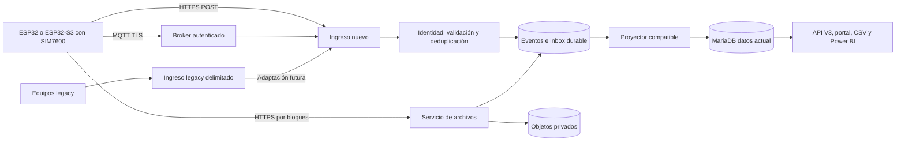

# Arquitectura y comparación

## Flujo propuesto

Durante la primera fase el flujo legacy permanece tal como está; su adaptación es un cambio futuro controlado. No habrá dos escritores para la misma muestra sobre `datos`.

El nuevo servicio tendrá identidad técnica y permisos mínimos. El broker no recibirá credenciales de MariaDB. El consumidor no dependerá de llamar al GET público. La recepción valida y guarda un evento durable; un proyector traduce a la forma histórica actual. Usar una inbox en MariaDB simplifica el piloto; un almacén de recepción separado se justifica si la contención afecta a la base principal. Separar procesos sin separar máquina mantiene un punto único de fallo.

## Alternativas

| Opción | Ventajas | Costos y límites | Uso recomendado |
|---|---|---|---|
| MQTT/TLS + HTTPS para archivos | Comunicación bidireccional, sesiones y bajo overhead por mensaje con conexión reutilizada | Broker, ACL, reconexión y ACK propios; conexión sostenida consume energía | Objetivo si se necesita estado o comandos remotos |
| HTTPS POST para todo | Menos componentes; fácil integración con proxy y cargas de archivos | Handshake y cabeceras pesan en envíos pequeños; comandos requieren consulta periódica | Primera opción válida para envío esporádico; puede ser la primera fase |
| AT MQTT(S)/HTTP(S) del SIM7600 | Menor pila de red en MCU; posible cambio acotado en legacy | Firmware del módem, buffers y URC condicionan compatibilidad | Piloto legacy si pasa pruebas TLS |
| PPPoS y TLS en ESP32 | Control sobre certificados y protocolos, mismo contrato por WiFi/celular | RAM, CPU, UART y coexistencia GNSS/AT | Preferencia para nuevo ESP32-S3 |
| Broker gestionado | Reduce operación de disponibilidad y certificados | Costo recurrente, cuotas, dependencia y residencia de datos | Considerar si falta capacidad operativa |
| CoAP/DTLS o LwM2M | Diseñado para dispositivos y gestión estructurada | Nueva pila, gateway y pruebas; no resuelve por sí mismo imágenes | Reevaluar si aparecen requisitos específicos |
| MQTT para todos los binarios | Un único canal lógico | Fragmentación, memoria, cuota y recuperación complejas | Solo objetos pequeños y necesidad demostrada |

Mosquitto permite comenzar con un alcance reducido. EMQX u otro broker se evaluarían si hacen falta clustering, administración de flota o integraciones concretas. Comparar edición, licencia, soporte y costo en la fecha de contratación; no elegir por un precio supuesto.

## Red y alojamiento

Los equipos pueden estar detrás de CGNAT: abren conexiones salientes y no necesitan IP pública propia. El broker sí necesita una dirección alcanzable. El túnel web existente no demuestra que MQTT TCP/8883 pueda publicarse de manera transparente.

Opciones: broker en VPS con TLS y conexión privada hacia el consumidor; broker gestionado; o puerto TCP publicado en infraestructura CMAS con firewall, DNS y certificado. MQTT sobre WSS/443 es una alternativa si el cliente lo soporta y se prueba el comportamiento del proxy. La publicación TCP con Cloudflare Tunnel puede requerir software de acceso del lado cliente; no asumir su disponibilidad en el SIM7600. [Protocolos de Cloudflare](https://developers.cloudflare.com/cloudflare-one/networks/connectors/cloudflare-tunnel/routing-to-tunnel/protocols/).

Para el piloto: proceso/VM aislado, cuotas CPU/RAM/disco y métricas. No abrir 1883 a Internet. Separar namespaces de laboratorio y producción, identidades y objetos. Preferir conservar los dominios actuales mientras el ingreso nuevo tiene su dirección propia. No introducir un redireccionamiento HTTP→HTTPS indiscriminado que corte equipos antiguos.
