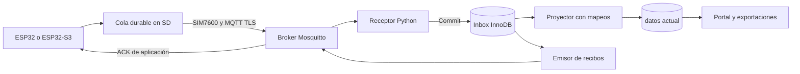
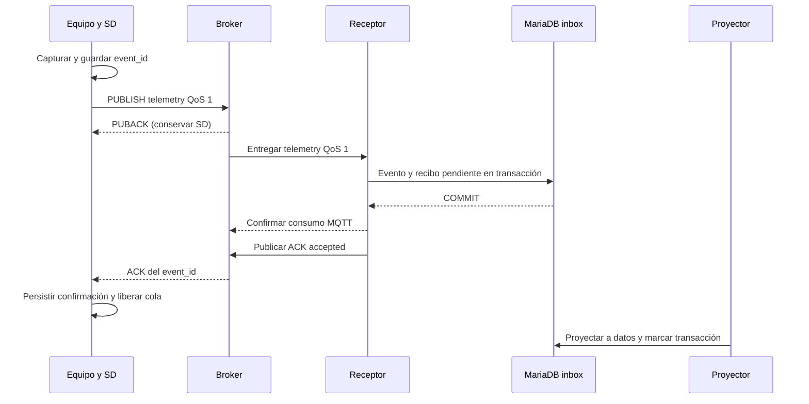

# MQTT en profundidad: diseño propuesto para CMAS

Ampliación del 5 de noviembre de 2026. Estado: propuesta documental, sin instalación ni cambio productivo. Leer junto con [contratos](03_CONTRATOS_Y_DATOS.md) y [especificación del piloto](10_MQTT_PILOTO.md). Los ejemplos utilizan identificadores ficticios.

## 1. Qué cambiaría para un equipo HIRI

Hoy el firmware construye una URL que enumera IDs de sensores, variables y valores y hace un GET. En el diseño nuevo, el equipo mantiene una conexión autenticada y publica un objeto de medición en una dirección lógica llamada topic. No sabe cómo se llama la tabla SQL ni puede escoger sensores de otros equipos. Un servicio CMAS transforma los canales lógicos a los IDs históricos.

El broker es el servidor que recibe publicaciones y entrega copias a suscriptores autorizados. El servicio de recepción es uno de esos suscriptores. Otros servicios pueden recibir eventos para funciones distintas, pero solo el proyector autorizado escribe en el histórico. MariaDB sigue siendo el registro consultado por los dashboards.

Propuesta concreta: Mosquitto, recepción Python con Paho, inbox InnoDB y proyector compatible con `datos`. Reutilizar conocimiento de Python/MariaDB del servidor facilita mantenimiento. No reutilizar sin rediseño el parser Kuscaya que termina llamando al GET público: su existencia demuestra experiencia local con MQTT, no los controles que necesitamos.

El broker puede estar fuera del servidor CMAS. El consumidor en CMAS se conecta hacia él como cliente saliente. Esto permite recibir MQTT sin publicar MariaDB ni crear una conexión entrante desde el broker a la base.

## 2. Dónde pondría el broker

| Despliegue | Ventaja | Desventaja | Decisión propuesta |
|---|---|---|---|
| Mismo host CMAS, proceso/VM aislado | Operación y respaldo conocidos | Comparte disco, electricidad, red y fallo con DB | Laboratorio; producción solo con publicación TCP y recursos comprobados |
| VPS separado con DNS y TLS | Accesible por los módems, aislamiento del servidor DB | Administración adicional y dependencia de Internet entre CMAS y VPS | Preferencia si CMAS no dispone de publicación TCP confiable |
| Broker gestionado | Reduce tareas de operación de broker | Cuotas, costo, integración de identidades y dependencia | Alternativa si no hay responsable para administrar VPS |

No contratar ni abrir puertos todavía. Primero verificar DNS, salida 8883 desde el APN y camino hacia CMAS. Mantener acceso administrativo restringido; 8883 es el servicio del equipo, no un puerto de administración. El túnel HTTP actual no demuestra disponibilidad para MQTT TCP. WSS/443 puede ser alternativa en ESP32 con soporte adecuado, pero no se debe suponer que el cliente AT del módem implementa WebSockets.

Una instancia de Mosquitto no equivale a un clúster. En el piloto se acepta una instancia con SD local en cada equipo y recuperación probada. Un balanceador delante de dos brokers independientes no comparte sesiones ni asegura continuidad. Alta disponibilidad requerirá diseño y pruebas específicos antes de prometerla.

## 3. Qué se publica y por qué

Un topic identifica una clase de mensajes, no es una URL para visitar en navegador. Propuesta: raíz `cmas/v1/devices/{uid}`. Separar laboratorio y producción en brokers/credenciales distintos; mantener el mismo contrato facilita pasar de uno a otro sin cambiar payloads.

| Sufijo | Sentido | Contenido | Política piloto |
|---|---|---|---|
| `/telemetry` | Equipo → recepción | Una captura con todos sus canales, posición y hora | QoS 1; sin retained |
| `/ack` | Servicio de recibos → equipo | Resultado durable de un event_id | QoS 1; sin retained |
| `/status` | Equipo → observador | Inicio, desconexión, versión y salud | QoS 1; sin retained |
| `/commands` | Control → equipo | Orden autorizada | Deshabilitado inicialmente |
| `/command-results` | Equipo → control | Resultado de una orden | Deshabilitado inicialmente |

Una captura conjunta evita que temperatura, partículas y GPS queden con horas inconexas por publicar cada variable en un topic separado. Mantener un evento por publicación en el primer piloto; la recuperación publica varios eventos independientes con límites. Los topics nunca contienen coordenadas, contraseñas ni IDs secretos.

En esta ampliación el piloto **no usa retained en ningún topic**. El estado actual se construye en servidor con la última recepción. La tabla general anterior permitía retained para estado como opción futura; no se adopta hasta resolver caducidad y políticas por topic. Un mensaje retained no es un histórico ni una cola de todos los valores.

## 4. Qué significa entrega confiable

MQTT ofrece QoS 0, 1 y 2. QoS 0 no incluye confirmación de entrega; QoS 1 puede repetir; QoS 2 agrega intercambios para controlar duplicados dentro del protocolo. Ninguno incorpora una transacción SQL del consumidor. Las suscripciones también tienen QoS: no alcanza con publicar QoS 1 si el receptor se suscribe QoS 0. [Especificación OASIS 3.1.1](https://docs.oasis-open.org/mqtt/mqtt/v3.1.1/os/mqtt-v3.1.1-os.html).

Para CMAS elegiría QoS 1 en ambos extremos, deduplicación por event_id y recibo de aplicación. No pagaría inicialmente la complejidad de QoS 2 porque todavía necesitaríamos esa deduplicación para reenvíos HTTP, reinicios y errores de aplicación.

Hay tres hitos distintos:

| Hito | Qué puede afirmar CMAS | ¿El equipo libera SD? |
|---|---|---|
| Módem/biblioteca aceptó enviar | Hay trabajo local de comunicación | No |
| PUBACK del broker | Se completó ese paso MQTT | No |
| Recibo `accepted` del servicio CMAS | Evento validado guardado en inbox durable | Sí, bajo el modelo de respaldo acordado |

`accepted` permite soltar la copia pendiente de transmisión; el archivo científico local puede conservarse más tiempo. `projected` significa que también se generaron las filas compatibles en `datos`. Si se necesita que el equipo retenga hasta este último estado, se puede endurecer la política, a costa de mayor SD y acoplamiento a la carga de MariaDB.

El recibo pendiente es una outbox en DB: una tabla de mensajes que el servidor aún debe publicar. Evita depender de que el proceso sobreviva justo después del commit. El esquema lógico general se amplía con `ingest_receipts_outbox`.

## 5. Recibir sin perder mensajes ni duplicar histórico

Algoritmo propuesto del receptor, expresado como diseño y no como código desplegable:

1. Aceptar solo topics de telemetría permitidos, con tamaño y versión válidos. Derivar uid del topic autorizado y exigir igualdad con el cuerpo.
2. Resolver mapeo de canales, generación habilitada y reglas estructurales; no aceptar IDs SQL del equipo.
3. Iniciar transacción: insertar evento bajo clave única `(device_uid, generation, sequence)` y recibo pendiente. Guardar bytes originales e integridad calculada, captura y recepción.
4. Si la clave existe, comparar contenido: idéntico devuelve resultado anterior; diferente registra conflicto. No crear otra muestra.
5. Hacer commit antes de emitir `accepted`. Un error de DB no produce éxito.
6. Confirmar el mensaje al broker y enviar el recibo de aplicación desde outbox.
7. El proyector bloquea el evento y genera filas de `datos` y trazabilidad por ordinal en la misma transacción InnoDB. Un reinicio antes de commit revierte todo; después encuentra el evento ya procesado.

Paho permite `manual_ack=True` y confirmar un mensaje después de procesarlo. Lo elegiría para que volver del callback no sea confundido con persistencia. No hacer escritura lenta en el hilo de red: usar cola RAM acotada y workers; la cola RAM no es el destino durable. Asociar cada trabajo a la generación de conexión para no confirmar un packet ID reutilizado después de reconectar. [API Paho](https://eclipse.dev/paho/files/paho.mqtt.python/html/client.html).

Un mensaje inválido permanente no debe bloquear el consumidor indefinidamente: registrar rechazo acotado y confirmar consumo; emitir rechazo al dispositivo si el event_id puede validarse. Un JSON ilegible o una identidad discordante no se usa para construir un topic de respuesta arbitrario. El dispositivo conserva los rechazos en cuarentena local hasta resolución, sin reenviarlos cada segundo.

El broker no entrega necesariamente al suscriptor la identidad del publicador como dato autenticado. Por eso la cadena de confianza depende de ACL estrictas que ligan identidad y topic. Si otros productores o puentes pueden publicar bajo cualquier uid, esa garantía se pierde. El servicio de ingesta no debe tener permiso para fabricar telemetría en nombre de equipos.

## 6. Identidad, permisos y revocación

Propuesta piloto: una identidad aleatoria por equipo, transportada exclusivamente por TLS con validación del servidor. UID público y clave secreta son distintos: conocer el UID, topic o dominio no permite escribir. No utilizar IMEI como contraseña. Las credenciales de la administración web tampoco se reutilizan en módems.

Para Mosquitto evaluaría Dynamic Security con relación explícita usuario–client ID y ACL por dispositivo. El plugin permite restringir esa combinación y deshabilitar identidades, desconectando sus sesiones; no está activo solo por instalar el broker. [Dynamic Security](https://mosquitto.org/documentation/dynamic-security/).

| Identidad | Puede publicar | Puede recibir | No puede |
|---|---|---|---|
| Equipo A | Telemetría y estado A | ACK A | Suplantar B, emitir ACK, leer otros equipos |
| Receptor | Nada de telemetría | Telemetría de equipos autorizados | Administrar broker, enviar comandos |
| Emisor de recibos | ACK de equipos autorizados | Solo lo necesario | Publicar mediciones |
| Observador | Ningún dato de dispositivo | Estado permitido | Insertar o confirmar muestras |
| Control futuro | Comandos autorizados | Resultados autorizados | Administrar identidades desde el firmware |

Denegar por defecto publicación, suscripción y entrega que no se hayan permitido; comprobar reglas efectivas del plugin, no asumir sus valores por defecto. Bloquear `$CONTROL`, `$SYS` y comodines generales para dispositivos. Vincular client ID a identidad para que A no pueda desconectar B usando su identificador de sesión.

mTLS agrega certificados individuales y evita contraseñas MQTT, pero requiere CA, emisión, renovación y revocación. Lo introduciría si hay un responsable de ese ciclo y pruebas en ambas generaciones de hardware. La CA para autenticar clientes debe ser deliberada y restringida; no confiar en cualquier certificado de cualquier CA pública como identidad CMAS. TLS de servidor y autenticación de cliente son controles distintos.

Una clave robada permite suplantar ese dispositivo hasta revocarla; limitarla a ese equipo reduce alcance. No prometer que MQTT prueba la veracidad física de una medición. Registrar calidad, calibración y procedencia sigue siendo necesario.

## 7. Caídas de señal, sesiones y consumo

La SD es la fuente de reenvío del equipo. La sesión del broker y la cola de la biblioteca son ayudas, no sustitutos de SD. ESP-MQTT documenta retransmisión y expiración de su outbox; su configuración no equivale por sí sola a persistencia resistente a apagados. [ESP-MQTT](https://docs.espressif.com/projects/esp-mqtt/en/latest/esp32/).

Propuesta de conexión: red disponible → TLS → CONNECT → suscribirse a ACK y esperar confirmación → publicar pendientes. Si el broker perdió la sesión, recrear suscripciones. Conectar con el mismo client ID autorizado; no generar uno distinto por reconexión.

Perfil base 3.1.1 con sesión persistente acotada. MQTT 5 permite Session Expiry, Message Expiry y límites negociados como Receive Maximum y Maximum Packet Size. Estas propiedades ayudan a gestionar colas y límites, pero no reemplazan el contrato de aplicación ni las cuotas propias. Usarlas solo si el cliente real las soporta; mantener compatibilidad 3.1.1. [OASIS MQTT 5](https://docs.oasis-open.org/mqtt/mqtt/v5.0/os/mqtt-v5.0-os.html).

Al perder cobertura: continuar capturando, no recrear mediciones; conservar hora e ID. Al recuperar, aplicar backoff con jitter y enviar pendientes a velocidad acotada, reservando una cuota para datos recientes. No exigir orden de llegada para deduplicar. No descartar automáticamente un evento antiguo válido solo porque su hora sea anterior a la última recibida.

Para alimentación continua, medir si mantener conexión es eficiente. Para despertar una vez por hora, conectar, transmitir lote y dormir puede ser mejor. MQTT reduce overhead con conexión reutilizada, pero el consumo del módem, registro celular, retransmisiones y TLS puede dominar. Comparar bytes y energía con HTTPS POST en el mismo hardware y cobertura.

Un LWT indica que se perdió una conexión, no que el sensor dejó de capturar. Incluir connection_id en el estado para distinguir avisos viejos de una reconexión nueva. La hora del LWT no es hora de avería; registrar cuándo lo observó el servidor. Para apagado previsto, publicar estado y desconectar de forma ordenada.

## 8. SIM7600: dos implementaciones concretas

**Legacy actualizable: MQTT(S) nativo AT.** El ESP32 prepara el evento; el módem ejecuta conexión y publicación. Secuencia conceptual: configurar red y TLS, iniciar servicio MQTT, adquirir cliente, seleccionar contexto TLS, configurar voluntad, conectar, suscribir ACK, cargar topic/payload y publicar. Interpretar resultado asíncrono, no solo el primer OK. El manual SIMCom consultado documenta comandos CMQTT, payloads de hasta 10 240 bytes y URC de recepción; los límites y el comportamiento deben verificarse contra firmware instalado. [Manual SIMCom](https://files.waveshare.com/upload/6/65/SIM7500_SIM7600_Series_MQTT_ATC_V1.01.pdf).

No copiar números de configuración SSL entre familias. El manual incluye opciones antiguas/inseguras que este diseño no acepta; exigir TLS 1.2+, CA, nombre y fecha, con pruebas negativas. SNI no equivale a comprobar el hostname. Si la pila no valida correctamente el servidor, esa ruta no pasa el piloto.

**ESP32-S3: PPPoS + TLS + ESP-MQTT en MCU.** SIM7600 proporciona acceso a Internet; el S3 ejecuta TLS, MQTT y HTTPS. Permite mantener el mismo contrato sobre WiFi o celular. Hay que resolver GNSS/AT simultáneo con PPP mediante CMUX probado o canal separado; la documentación esp_modem describe estos modos y soporta SIM7600. [esp_modem](https://docs.espressif.com/projects/esp-protocols/esp_modem/docs/latest/README.html).

No elegir PubSubClient suponiendo QoS 1 de publicación: su documentación indica que publica solo QoS 0, aunque puede suscribirse con QoS 1. Su buffer predeterminado también es pequeño. Puede servir para otra arquitectura con reintento propio, pero no cumple directamente el perfil seleccionado. [PubSubClient](https://github.com/knolleary/pubsubclient).

En ambos caminos mantener drivers/UI, separar tareas y conservar un único propietario del módem. La recepción MQTT puede llegar entre respuestas AT o en fragmentos; ensamblar por longitudes declaradas, no por suponer un JSON completo en una línea. Limitar memoria y tratar URC fuera de orden. No convertir el loop de adquisición en una espera bloqueante hasta que termine la red.

## 9. Imágenes, trayectorias y comandos

Una latitud y longitud son telemetría ordinaria. Miles de puntos de una ruta pueden enviarse como eventos sucesivos con orden por captura; una exportación GeoJSON/GPX extensa se maneja como archivo. No hace falta otra base para aceptar posiciones puntuales; consultas espaciales avanzadas serían una decisión posterior.

Una imagen se sube por HTTPS y MQTT transporta media_id, captura y estado. El evento que anuncia `ready` debe proceder del servicio que verificó el objeto; un equipo puede anunciar que tiene una captura pendiente, pero no certificar por sí mismo la persistencia del archivo en servidor. Identificar productor con topics separados si se incorpora ese evento de servicio; no dar permiso al dispositivo para emitirlo.

Si fuese obligatorio transportar fotos por MQTT, se necesitarían transfer_id, índice/total de bloques, integridad por bloque y total, límites de concurrencia, expiración, consulta de bloques faltantes y almacenamiento temporal. Es viable como protocolo adicional, pero duplica trabajo del cargador HTTPS y compite por colas con mediciones. No se propone para el piloto. Un JSON base64 tampoco elimina ese costo.

Comandos se incorporarían después: command_id, destinatario, expiración, precondiciones, versión de configuración y registro de resultado. Repetir una orden no debe repetir su efecto físico. Preferir “fijar intervalo a 60 segundos” frente a “disminuir intervalo”, que se comporta distinto al duplicarse. No retener órdenes de reinicio ni confiar únicamente en TTL del broker. Firmware verifica autorización, vigencia y registro durable de ejecución. Sin reloj válido, rechazar órdenes que dependan de expiración hasta sincronizar; separar sincronización de acciones sensibles.

## 10. Qué habría que demostrar antes de migrar

Primero un equipo ESP32 y uno ESP32-S3, ambos con SIM7600, en laboratorio. Después sombra sin escribir duplicados en `datos`. Finalmente corte de un dispositivo, con bloqueo V1/V2/CRUD sobre sus sensores. Mantener HTTP anónimo para el mismo dispositivo dejaría abierta la misma suplantación aunque MQTT estuviera perfectamente configurado.

La condición de éxito es verificable: una captura sobrevive a cortes y reintentos, entra con identidad correcta, conserva la hora y produce una sola proyección en el histórico. El siguiente documento convierte esa condición en mensajes, parámetros y pruebas del piloto.
